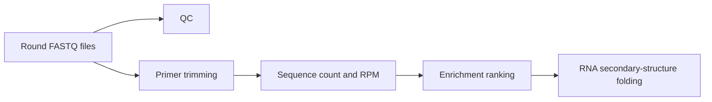
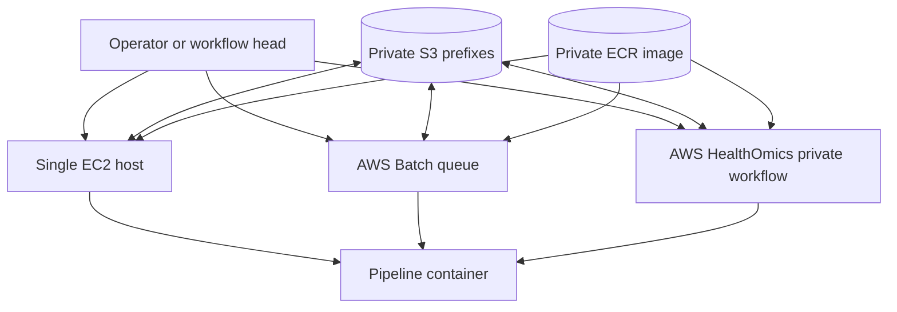

[English](architecture.md) | [한국어](architecture.ko.md)

# 아키텍처 가이드

이 가이드는 과학 파이프라인과 그것을 실행하는 서비스를 나눠서 설명합니다. 같은 다섯 단계를 Bash에서 순서대로 실행할 수도 있고, AWS Batch, Nextflow, AWS HealthOmics가 조율하는 작업으로 실행할 수도 있습니다.

이 저장소는 독립적인 교육용 프로젝트이며, AWS 공식 샘플이나 템플릿이 아닙니다.

## 과학적 흐름



**FASTQ** 파일은 시퀀싱 read와 염기마다의 신뢰도 점수를 저장합니다. **RPM**은 reads per million으로, 라이브러리 크기를 맞추는 정규화입니다. **농축(enrichment)**은 선별 라운드 사이에서 어떤 서열의 상대적 비율이 늘어나는 것을 말합니다.

D1은 Ion Torrent로 얻은 공개 RNA SELEX 데이터입니다. 고객 DNA 데이터가 아니며 Illumina 데이터도 아닙니다. 분자 동역학 시뮬레이션은 이 아키텍처에 포함되지 않습니다.

## 실행 계층



**workflow head**는 어떤 작업이 실행 준비가 됐는지 판단하고 제출하는 Nextflow 프로세스입니다. 작업을 조율할 뿐 과학 계산을 직접 하지는 않습니다. **ECR**은 파이프라인 이미지의 private 사본을 보관하는 Amazon Elastic Container Registry입니다.

## 패턴 A: EC2에서 Bash

private EC2 인스턴스 하나가 S3에서 입력을 복사하고, 로컬 POSIX 스토리지에서 모든 단계를 실행하고, 최종 출력을 업로드합니다. 이해하기 쉬운 기준 결과를 얻을 수 있고 디버깅이 단순합니다.

머신 한 대로 충분하거나 기준 결과를 만들 때 이 패턴을 쓰세요. 대신 호스트 하나가 스케줄링, 확장, 재시도, 로컬 디스크 용량을 모두 떠안습니다.

## 패턴 B: AWS Batch copy-in

Batch job 하나가 세 가지를 합니다.

1. 바뀌지 않는 S3 입력 prefix를 작업 로컬 스토리지로 복사합니다.
2. 단계 로직을 바꾸지 않고 `pipeline/run_pipeline.sh`를 실행합니다.
3. 결과를 고유한 private S3 출력 prefix로 업로드합니다.

잘 동작하는 Bash 파이프라인에서 가장 적게 바꾸는 이전 방식입니다. 입력 복사 시간과 로컬 스토리지 요구량도 눈에 보이게 됩니다.

## 패턴 C: AWS Batch dependency

job을 나누면 단계 경계가 드러납니다.

```text
S1 QC array --N_TO_N--> S2 trim array --N_TO_N--> S3 count array
                                                          |
                                                          v
                                                    S4 enrichment
                                                          |
                                                          v
                                                     S5 folding
```

**array job**은 번호가 붙은 자식 job을 가진 Batch 제출 하나입니다. 이 설계에서 번호는 SELEX 라운드를 뜻합니다. `N_TO_N`은 trim 자식이 같은 번호의 QC 자식만 기다리고, count 자식이 맞는 trim 자식만 기다린다는 뜻입니다. 농축 분석은 라운드끼리 비교하므로 S4는 S3 array 전체를 기다립니다. S5는 S4를 기다립니다.

모든 단계는 실행별 S3 prefix에 씁니다. job definition은 멱등적이어야 합니다. 같은 불변 입력으로 job을 재시도하면 실행끼리 섞이지 않고 같은 결과가 나와야 합니다. 포함된 Batch task role은 스택의 `runs/` prefix 아래 모든 실행에 접근할 수 있으므로, IAM으로 실행끼리 격리해야 한다면 스택을 나누거나 실행별 역할이 필요합니다.

## 패턴 D: AWS Batch에서 Nextflow

Nextflow는 같은 그래프를 `nextflow/main.nf`로 표현합니다. `awsbatch` executor는 준비된 process마다 Batch job 하나를 제출합니다. S3에는 Nextflow work 디렉터리와 게시된 출력이 저장됩니다.

Nextflow를 쓰면 직접 짜는 오케스트레이션 코드가 줄고, 작업 재시도와 `-resume`을 쓸 수 있습니다. head 프로세스는 워크플로가 끝날 때까지 살아 있어야 합니다. 그 상태와 `.nextflow.log`를 보호하되, 민감한 경로나 식별자가 담긴 로그는 공개하지 마세요.

## 패턴 E: Mountpoint 입력을 쓰는 Nextflow

Batch 컴퓨팅 호스트가 private S3 버킷을 마운트하고, 그 호스트 경로를 작업 컨테이너에 읽기 전용으로 노출합니다. 워크플로는 Nextflow에게 staging을 맡기지 않고 마운트된 파일 이름을 문자열로 전달합니다.

Mountpoint는 완전한 POSIX 호환이 아닙니다. 도구 호환성은 실제 파일 접근 패턴에 달려 있습니다. 테스트를 마친 읽기 전용 입력에만 마운트된 스토리지를 쓰세요. `TMPDIR`, 작업 출력, Nextflow work 디렉터리는 로컬 POSIX 스토리지나 Nextflow의 기본 S3 스토리지에 두세요. Nextflow work 디렉터리를 Mountpoint에 두지 마세요.

## 패턴 F: AWS HealthOmics

HealthOmics는 패키징한 Nextflow 정의를 private workflow로 실행합니다. **run role**은 HealthOmics가 입력을 읽고, 출력을 쓰고, 암호화를 쓰고, 이미지를 가져올 때 맡는 IAM 역할입니다.

포함된 도우미는 restricted 네트워킹을 요청합니다. 쉽게 말해 워크플로 작업에 일반적인 퍼블릭 인터넷 접근이 주어지지 않습니다. 모든 실행 파일과 의존성을 같은 리전의 private ECR 이미지에 넣고, 워크플로 입력은 허가된 private S3 위치에 두세요.

선택 사항인 VPC 네트워킹 모드는 HealthOmics가 관리하는 네트워크 인터페이스를 공유 private subnet에 두고 실행 트래픽을 보냅니다. **이 저장소에서 아직 검증되지 않았습니다.** [HealthOmics 가이드](getting-started/30-healthomics.ko.md#선택-vpc-네트워킹-모드-아직-검증되지-않음)를 보세요.

## 패턴 G: AWS Batch에서 RaptGen, CPU 또는 GPU

RaptGen은 별도의 모델 학습 작업입니다. 자체 job definition(`raptgen/batch/jobs.yaml`)과 이미지를 쓰고, 같은 Batch 스택의 CPU 큐, GPU 큐, 또는 둘 다에서 실행됩니다. GPU compute environment는 ECS GPU 최적화 Amazon Linux 2023 이미지를 쓰고, CPU와 같은 private subnet과 security group을 씁니다. [Batch에서 RaptGen](raptgen/batch.ko.md)을 보세요.

## 신뢰 경계

**신뢰 경계(trust boundary)**는 권한이 서로 다른 구성 요소 사이에서 데이터나 권한이 넘어가는 지점입니다.

| 경계 | 필요한 통제 |
|---|---|
| 운영자에서 AWS API로 | 대상 환경으로 제한된 임시 자격 증명과 역할 |
| workflow head에서 Batch로 | job 제출과 조회 권한만, 넓은 데이터 관리 권한은 없음 |
| job에서 S3로 | 설정된 입력 prefix 읽기와 스택의 `runs/` prefix 읽기/쓰기. `RUN_ID`는 관례로 job을 나눌 뿐, 실행별 IAM 격리가 아님 |
| 컴퓨팅 호스트에서 마운트된 S3로 | Mountpoint 입력용 읽기 전용 버킷 접근 |
| HealthOmics에서 S3와 ECR로 | 데이터 범위 하나와 이미지 리포지토리 하나로 제한된 전용 run role |
| 공개 D1 아카이브에서 로컬 또는 S3 스토리지로 | HTTPS 다운로드와 체크섬 검증 |

모든 경계에 넓은 역할 하나를 쓰지 마세요. 비대화형 워크플로를 위해 버킷을 공개하거나, 작업 포트를 열거나, 인바운드 접근을 추가하지 마세요.

## 패턴 고르기

먼저 Bash로 정확성을 확인하세요. 이전이 간단해야 하면 Batch copy-in을 쓰세요. 단계별 통제가 필요하면 stage dependency를 쓰세요. 워크플로 이식성, 자동 그래프 관리, resume 동작이 head 프로세스를 둘 만한 가치가 있으면 Nextflow를 쓰세요. Mountpoint는 접근 패턴을 테스트한 뒤에만 쓰세요. 관리형 생물정보학 워크플로 런타임이 거버넌스와 운영 요구 사항에 맞으면 HealthOmics를 쓰세요.

컴퓨팅보다 스토리지 동작이 아키텍처를 먼저 결정하는 경우가 많습니다. [storage.ko.md](storage.ko.md)로 이어 간 다음, [validation.ko.md](validation.ko.md)로 합격 기준이 될 증거를 정하세요.
