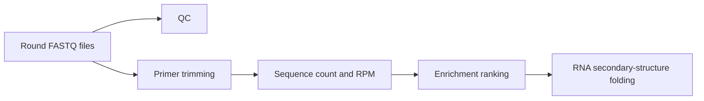
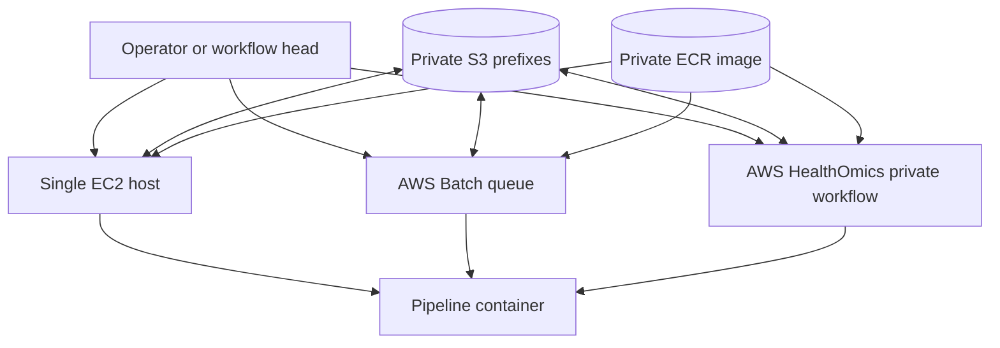

# Architecture guide

This guide separates the scientific pipeline from the service that runs it. The same five stages can run sequentially in Bash or as tasks coordinated by AWS Batch, Nextflow, or AWS HealthOmics.

This repository is an independent educational project, not an official AWS sample or template.

## Scientific flow



A **FASTQ** file stores sequencing reads and a confidence score for every base. **RPM** means reads per million, a library-size normalization. **Enrichment** is an increase in a sequence's relative abundance between selection rounds.

D1 uses public RNA SELEX data from Ion Torrent. It is not customer DNA data and it is not Illumina data. Molecular dynamics simulation is outside the architecture.

## Execution layers



The **workflow head** is the Nextflow process that decides which task is ready and submits it. It coordinates work but does not perform the scientific computation itself. **ECR** is Amazon Elastic Container Registry, where a private copy of the pipeline image is stored.

## Pattern A: Bash on EC2

One private EC2 instance copies inputs from S3, runs all stages on local POSIX storage, and uploads final outputs. This produces an understandable reference result and keeps debugging simple.

Use this pattern when one machine is sufficient or when establishing a baseline. The tradeoff is that one host owns scheduling, scaling, retries, and local disk capacity.

## Pattern B: AWS Batch copy-in

One Batch job performs three actions:

1. Copy an immutable S3 input prefix to task-local storage.
2. Run `pipeline/run_pipeline.sh` without changing its stage logic.
3. Upload the result to a unique private S3 output prefix.

This is the smallest migration from a working Bash pipeline. It also makes input-copy time and local storage requirements visible.

## Pattern C: AWS Batch dependencies

Separate jobs expose stage boundaries:

```text
S1 QC array --N_TO_N--> S2 trim array --N_TO_N--> S3 count array
                                                          |
                                                          v
                                                    S4 enrichment
                                                          |
                                                          v
                                                     S5 folding
```

An **array job** is one Batch submission with indexed child jobs. In this design, the index represents a SELEX round. `N_TO_N` means that a trim child waits only for the QC child with the same index, and a count child waits only for the matching trim child. S4 waits for the full S3 array because enrichment compares rounds. S5 waits for S4.

Every stage writes to a run-specific S3 prefix. Job definitions must be idempotent: retrying a job with the same immutable input should produce the same result without mixing runs. The included Batch task role can access every run under the stack's `runs/` prefix, so separate stacks or per-run roles are required when runs must be isolated from each other by IAM.

## Pattern D: Nextflow on AWS Batch

Nextflow expresses the same graph in `nextflow/main.nf`. The `awsbatch` executor submits one Batch job per ready process. S3 holds the Nextflow work directory and published outputs.

Nextflow reduces custom orchestration code and supports task retries and `-resume`. The head process must remain available until the workflow ends. Protect its state and `.nextflow.log`, but do not publish logs that contain sensitive paths or identifiers.

## Pattern E: Nextflow with Mountpoint input

A Batch compute host mounts a private S3 bucket and exposes that host path read-only to the task container. The workflow passes the mounted file name as a string instead of asking Nextflow to stage it.

Mountpoint is not fully POSIX-compliant. Tool compatibility depends on actual file-access patterns. Use mounted storage only for read-only inputs that have been tested. Keep `TMPDIR`, task outputs, and the Nextflow work directory on local POSIX or native S3-backed Nextflow storage. Never place the Nextflow work directory on Mountpoint.

## Pattern F: AWS HealthOmics

HealthOmics runs the packaged Nextflow definition as a private workflow. A **run role** is the IAM role that HealthOmics assumes to read inputs, write outputs, use encryption, and pull the image.

The included helper requests restricted networking. In plain terms, workflow tasks do not receive general public-internet access. Package every executable and dependency in the same-Region private ECR image, and keep workflow inputs in authorized private S3 locations.

## Trust boundaries

A **trust boundary** is a point where data or authority moves between components with different permissions.

| Boundary | Required control |
|---|---|
| Operator to AWS API | Temporary credentials and a role limited to the intended environment |
| Workflow head to Batch | Permission to submit and inspect jobs, but no broad data-administration permission |
| Job to S3 | Read the configured input prefix and read/write the stack's `runs/` prefix; `RUN_ID` separates jobs by convention, not by per-run IAM isolation |
| Compute host to mounted S3 | Read-only bucket access for Mountpoint inputs |
| HealthOmics to S3 and ECR | A dedicated run role limited to one data scope and image repository |
| Public D1 archive to local or S3 storage | HTTPS download plus checksum verification |

Do not use one broad role for every boundary. Do not make buckets public, publish task ports, or add inbound access for a non-interactive workflow.

## Choosing a pattern

Start with Bash to establish correctness. Use Batch copy-in when migration simplicity matters. Use stage dependencies when stage-level control is required. Use Nextflow when workflow portability, automatic graph management, and resume behavior justify a head process. Use Mountpoint only after access-pattern testing. Use HealthOmics when a managed bioinformatics workflow runtime fits the governance and operating requirements.

Storage behavior often decides the architecture before compute does. Continue with [storage.md](storage.md), then define acceptance evidence with [validation.md](validation.md).
