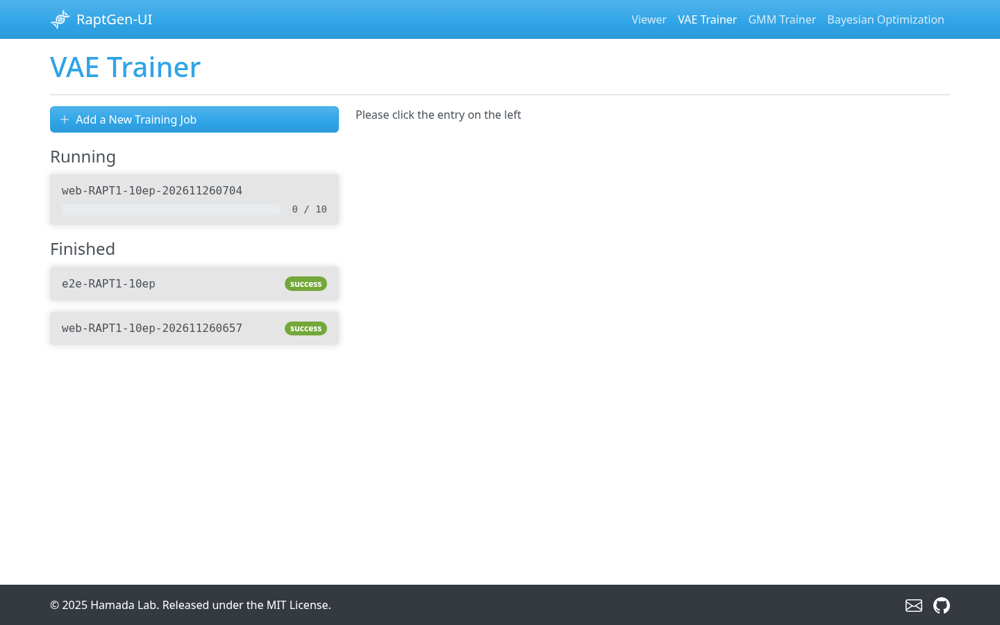
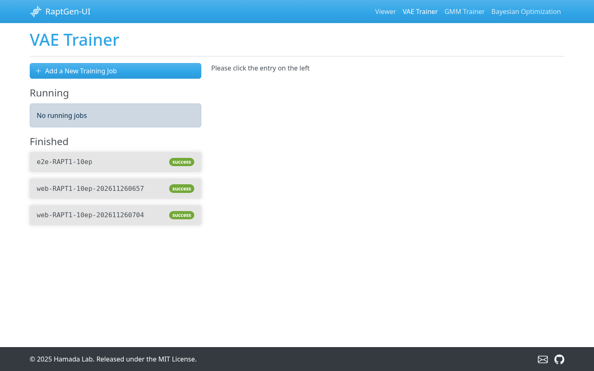
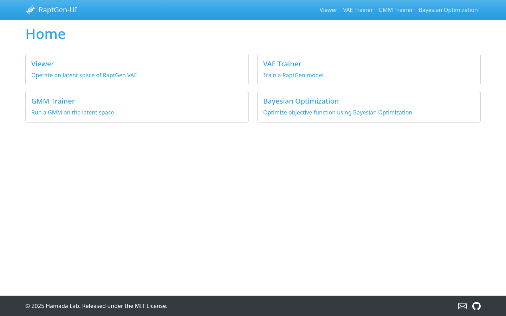
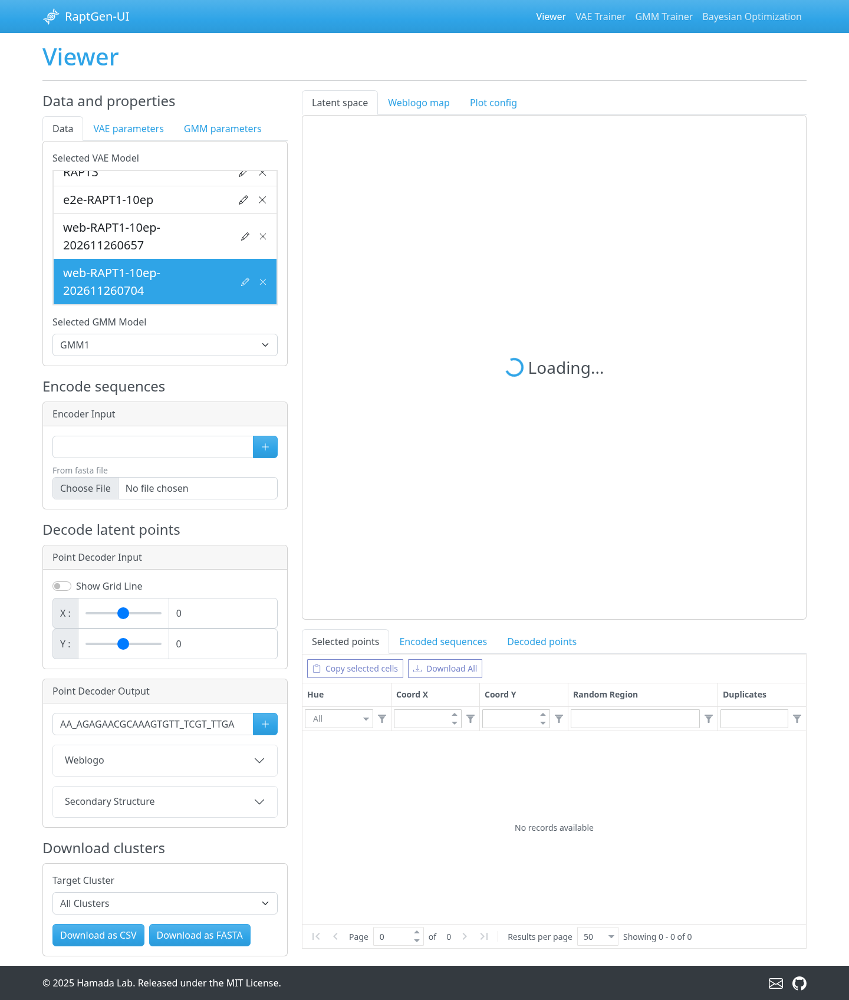
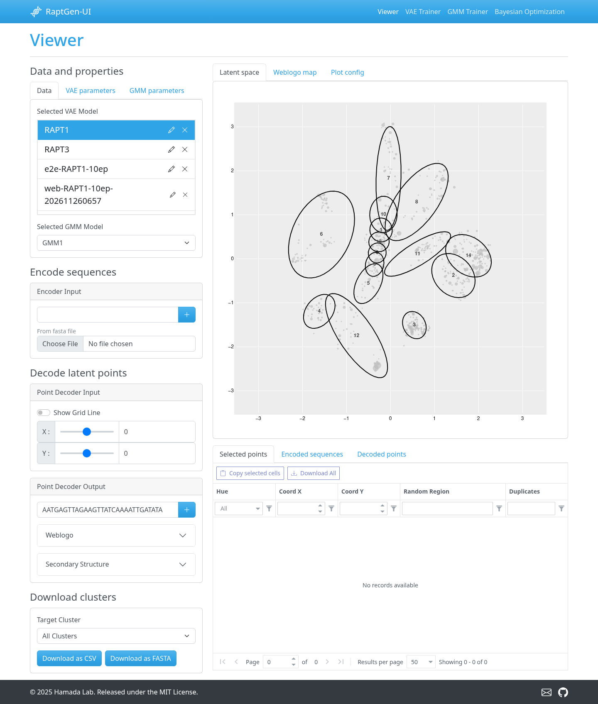

[English](ui-web.md) | [한국어](ui-web.ko.md)

# RaptGen-UI 웹 접속 (선택): CloudFront + Cognito

[사설 EC2에서 RaptGen-UI 실행](ui.ko.md)에 더하는 **선택** 기능입니다. SSM 터널 없이 로그인 뒤에서 HTTPS 브라우저로 RaptGen-UI를 열 수 있게 합니다. 터널로 충분하다면 이 문서는 건너뛰세요.

> **경고. 배포하기 전에 읽으세요.**
>
> - RaptGen-UI에는 **사용자별 데이터 구분이 없습니다.** `raptgen-full` 역할의 모든 사용자는 모든 모델을 보고 **모든 모델을 삭제할 수 있습니다.** full 역할은 그래도 되는 사람에게만 주세요. 나머지 사람에게는 `raptgen-readonly`를 주세요.
> - 이 옵션은 사이트를 Cognito 로그인 뒤에 두지만 **인터넷에서 접근할 수 있게** 합니다. `scripts/verify-gate.sh`가 통과한 **뒤에만**(2단계) 사용자를 만드세요. 직접 가입은 꺼져 있고 관리자가 모든 사용자를 만듭니다.
> - gate를 검증하기 전에 origin을 열지 마세요(3단계). 먼저 검증하고, 그다음에 여세요.
> - CloudFront에서 EC2 호스트까지는 VPC 안의 일반 HTTP입니다 (CloudFront VPC origin). 브라우저 쪽은 HTTPS입니다.
> - 공개 데이터 또는 민감하지 않은 서열 데이터만 사용하세요.

기술 참조: [`raptgen/ui-web/README.md`](../../raptgen/ui-web/README.ko.md).

## 동작 방식

```text
브라우저 -HTTPS-> CloudFront -> Lambda@Edge (Cognito 로그인 + 역할 확인, fail-closed)
                                   |
                                   v
         VPC origin (private subnet의 CloudFront 네트워크 인터페이스) -HTTP:18042-> UI EC2 (public IP 없음)
                                               RaptGen-UI frontend -> backend / worker / db / redis
```

**Amazon CloudFront**는 HTTPS 주소를 주는 콘텐츠 전송 서비스입니다. **Amazon Cognito**는 사용자 로그인 서비스입니다. **Lambda@Edge**는 CloudFront가 모든 요청에서 실행하는 작은 함수로, 로그인 토큰과 역할을 확인합니다. **VPC origin**은 public IP가 없는 private subnet의 호스트에 CloudFront가 닿게 해 줍니다.

edge 함수 안에서 무엇이든 실패하면 요청은 503을 받고 전달되지 않습니다 (fail-closed).

### 두 가지 역할

역할은 검증된 ID 토큰을 기준으로 edge에서 강제됩니다.

| | `raptgen-full` | `raptgen-readonly` |
|---|---|---|
| 페이지 열기, 모델/job 목록 | 가능 | 가능 |
| Viewer의 encode, decode, weblogo | 가능 | 가능 |
| 업로드, VAE/GMM 학습, 모델 등록 | 가능 | 403 |
| Bayesian optimization | 가능 | 403 |
| 이름 변경, 삭제 | 가능 | 403 |
| 어떤 그룹에도 속하지 않은 사용자 | 403 | 403 |

Next.js 이미지 최적화 경로 `/_next/image`는 모두에게 막혀 있습니다 (쓰지 않는 경로).

## 시작하기 전에

- [ui](ui.ko.md)로 만든 동작하는 UI 호스트. **loopback이 아니라 private IP에서 listen하도록** 설치해야 합니다. loopback만 쓰는 설치에는 CloudFront가 닿지 못합니다.

  ```bash
  raptgen/ui/install.sh --instance-id "$INSTANCE_ID" --bind-private-ip
  ```

  UI가 이미 도는 호스트에서 `install.sh`를 다시 실행하면 checkout을 고정된 commit으로 되돌리고, 패치를 다시 적용하고, 다시 빌드하므로 bind 주소가 바뀝니다 (이 저장소에서 다시 테스트하지는 않았습니다). 이후 SSM 터널에도 private IP가 필요합니다. `raptgen/ui/connect.sh --instance-id "$INSTANCE_ID" --remote-host <PrivateIp>` (`<prefix>-raptgen-ui` 스택의 output `PrivateIp`).
- Node.js 22 이상과 npm.
- **us-east-1**에 bootstrap된 AWS CDK (Lambda@Edge는 us-east-1에 있어야 합니다): `npx cdk bootstrap aws://<ACCOUNT_ID>/us-east-1`.
- UI 호스트 스택 `<prefix>-raptgen-ui`의 output `InstanceArn`, `PrivateDnsName`, `SecurityGroupId`.
- 비용: CloudFront 요청과 데이터 전송, Lambda@Edge 호출, Cognito 사용자, 로그 버킷, Secrets Manager 시크릿, 그리고 앞 가이드의 UI 호스트. 요금 페이지를 확인하세요.

```bash
export STACK_PREFIX=aptamer-workflows
UI_OUT() { aws cloudformation describe-stacks --stack-name "$STACK_PREFIX-raptgen-ui" \
  --query "Stacks[0].Outputs[?OutputKey=='$1'].OutputValue" --output text; }
INSTANCE_ARN=$(UI_OUT InstanceArn); PRIVATE_DNS=$(UI_OUT PrivateDnsName); UI_SG=$(UI_OUT SecurityGroupId)
echo "$INSTANCE_ARN $PRIVATE_DNS $UI_SG"
```

(CLI 기본 Region이 UI 호스트의 Region과 다르면 `--region <UI-HOST-REGION>`을 붙이세요.)

## 순서대로 배포

순서가 중요합니다. gate를 배포하고, **검증하고**, origin을 열고, 그다음에 사용자를 만듭니다.

### 1단계. gate 배포

```bash
cd raptgen/ui-web
npm install
npx tsx --test edge/authz.test.ts          # 역할 규칙 단위 테스트
npm run deploy -- \
  -c originInstanceArn="$INSTANCE_ARN" \
  -c originPrivateDns="$PRIVATE_DNS" \
  -c cognitoDomainPrefix=<unique-prefix>
```

`originPort`의 기본값은 18042입니다. `cognitoDomainPrefix`는 Region 안에서 유일해야 하고 `aws`, `amazon`, `cognito`를 포함하면 안 됩니다. 생략하면 계정에서 계산한 안정적인 `raptgen-ui-<16진수 10자리>` 값이 쓰입니다. gate는 항상 us-east-1에 만들어집니다. 계정, Region, 인스턴스, 도메인은 코드에 박혀 있지 않고 AWS CLI 설정과 위의 context 값에서 옵니다.

CloudFormation 스택 `RaptGenUiWeb`이 `CREATE_COMPLETE`가 되고 `SiteUrl`, `UserPoolId`, `CognitoDomain` 같은 output이 보여야 합니다. CloudFront 배포에는 몇 분이 걸릴 수 있습니다.

### 2단계. 익명 접근이 거부되는지 검증

```bash
scripts/verify-gate.sh
```

모든 줄이 `OK`이고 종료 코드가 0이어야 합니다. 모든 페이지와 API 경로(모든 method)가 **이** pool의 Cognito 로그인으로 redirect되는지, 위조한 OAuth callback과 위조한 토큰 쿠키가 거부되는지, `/logout`이 Cognito logout으로 가는지 확인합니다. `FAIL` 줄이 있으면 멈추고 3단계로 넘어가지 마세요.

### 3단계. origin을 CloudFront에만 열기

UI 호스트에는 인바운드 규칙이 없습니다. 이 단계는 CloudFront VPC origin 서비스 보안 그룹만 18042 포트에 닿게 하는 규칙 하나를 추가합니다. 그 그룹은 UI 호스트의 VPC에 있습니다 (CloudFront가 만들며 이름은 `CloudFront-VPCOrigins-Service-SG`).

```bash
CF_SG=$(aws ec2 describe-security-groups \
  --filters Name=group-name,Values=CloudFront-VPCOrigins-Service-SG Name=vpc-id,Values=<VpcId> \
  --query 'SecurityGroups[0].GroupId' --output text)
aws cloudformation deploy --stack-name "$STACK_PREFIX-raptgen-ui-origin-access" \
  --template-file origin-access.yaml \
  --parameter-overrides UiSecurityGroupId="$UI_SG" CloudFrontVpcOriginSecurityGroupId="$CF_SG"
```

### 4단계. 사용자 추가

```bash
scripts/add-user.sh <username> full        # 학습과 삭제 가능
scripts/add-user.sh <username> readonly    # 보기만 가능
```

스크립트는 임의의 영구 비밀번호로 Cognito 사용자를 만들고, 비밀번호를 us-east-1의 Secrets Manager `/raptgen-ui-web/users/<username>`에 저장합니다. 비밀번호를 출력하지 않습니다. 읽으려면:

```bash
aws secretsmanager get-secret-value --region us-east-1 \
  --secret-id /raptgen-ui-web/users/<username> --query SecretString --output text
```

각 사람에게는 본인 자격 증명만 안전한 방법으로 전달하세요. 1단계의 `SiteUrl`을 열어 로그인합니다.

## 테스트 결과

역할 end-to-end 테스트(`scripts/e2e-roles.ts`, Playwright)는 이 설계를 이전에 배포했을 때 통과했습니다.

- 로그인 없이: 모든 경로가 로그인 화면으로 redirect, 위조 토큰 거부 (`verify-gate.sh` 15개 중 15개 통과).
- full 사용자: 웹으로 RAPT1 샘플 학습(10 epoch, 212초), 모델 등록, GMM과 Bayesian optimization 실행, 후보 서열 decode.
- readonly 사용자: 보기, encode, decode는 200. 학습, 업로드, GMM, Bayesian optimization, 삭제, 이름 변경은 모두 403. 모델 수는 변하지 않음.
- 로그아웃 뒤에는 다시 로그인 화면.

| full 역할: 학습 진행 중 | full 역할: 학습 완료 |
|---|---|
|  |  |

| full 역할: 홈 | full 역할: Viewer의 새 모델 | readonly 역할: Viewer |
|---|---|---|
|  |  |  |

직접 실행하려면:

```bash
npx playwright install chromium
SITE_URL=https://<SiteUrl> FULL_USER=<name> FULL_PW_FILE=<file> RO_USER=<name> RO_PW_FILE=<file> \
FASTQ=<RAPT1_4R.fastq 경로> SHOT_DIR=./shots npm run e2e
```

| 검증일 | 결과 |
|---|---|
| `TODO(validation)` | 이 저장소로 1~4단계를 새로 배포하고 verify-gate와 역할 테스트 실행: 결과와 날짜를 여기에 추가 |

## 접속 닫기

필요한 것을 고르세요.

1. **호스트로 가는 경로 닫기:** origin-access 스택을 지웁니다. 유일한 인바운드 규칙이 사라집니다.

   ```bash
   aws cloudformation delete-stack --stack-name "$STACK_PREFIX-raptgen-ui-origin-access"
   ```

2. **또는 CloudFront distribution 비활성화** (CloudFront 콘솔).
3. **사용자 한 명 삭제:** `aws cognito-idp admin-delete-user --region us-east-1 --user-pool-id <UserPoolId> --username <name>`.
4. **전부 삭제:** `raptgen/ui-web`에서 `npx cdk destroy`를 실행하면 gate가 지워집니다. user pool, 로그 버킷, 사용자 시크릿은 **보존**되므로 직접 지우세요.

돌아가기: [사설 EC2에서 RaptGen-UI 실행](ui.ko.md) | [목차](README.ko.md)
