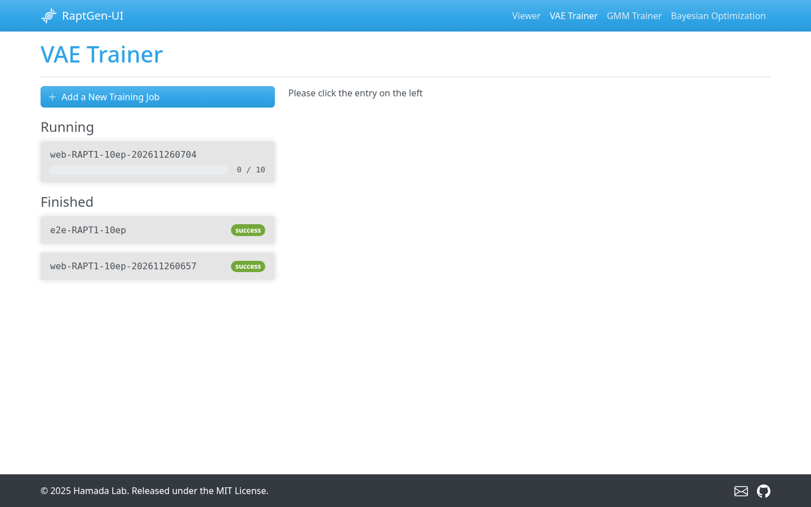
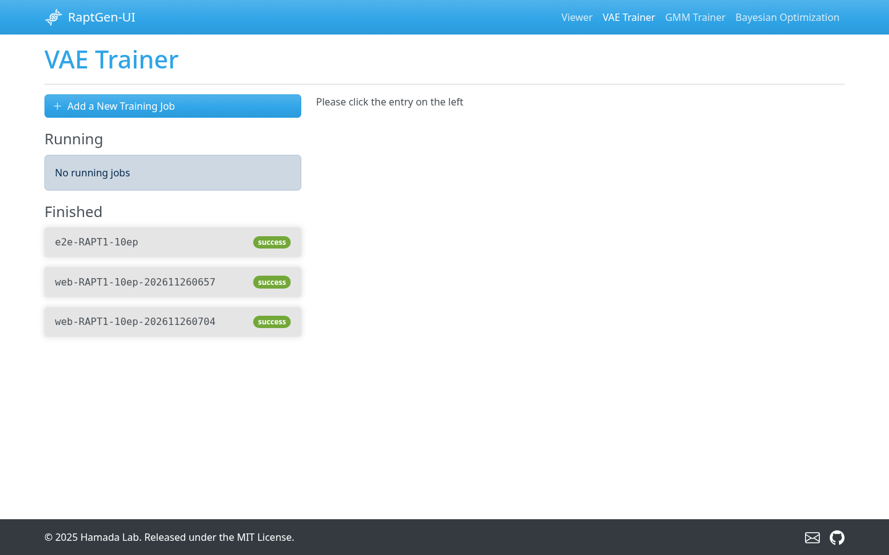
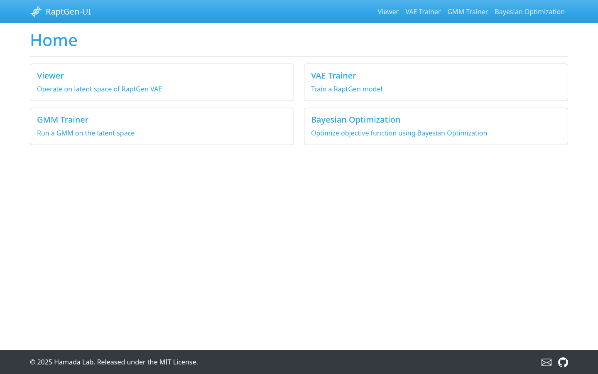
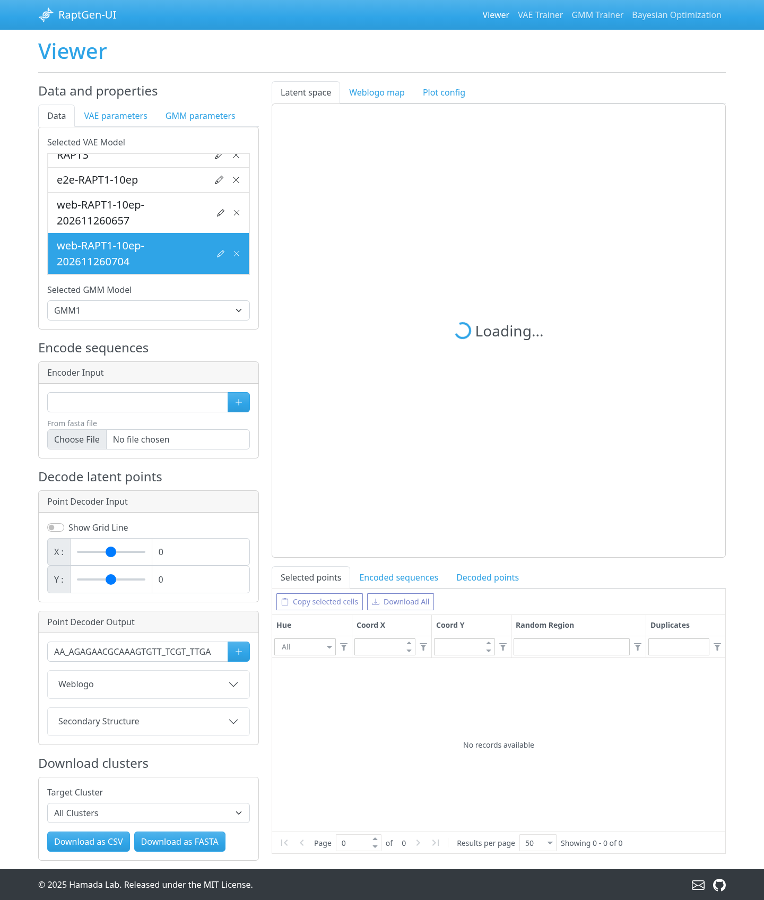
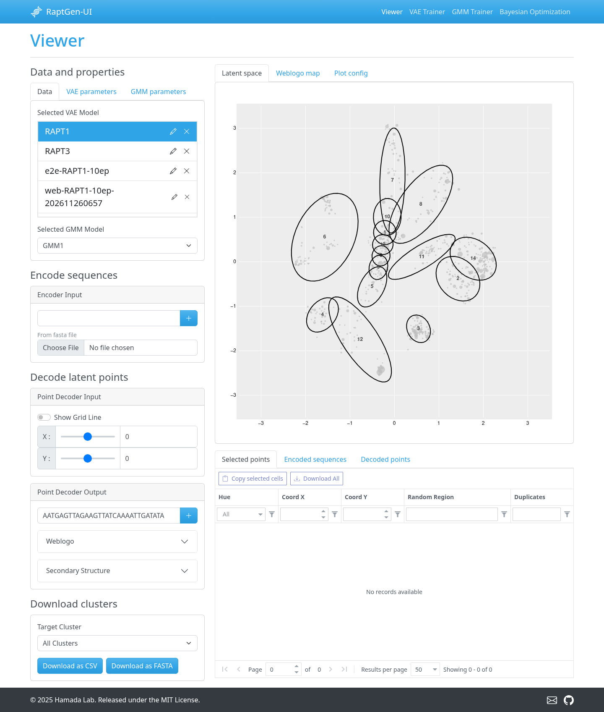

[English](ui-web.md) | [한국어](ui-web.ko.md)

# RaptGen-UI web access (optional): CloudFront + Cognito

This is an **optional** add-on to [RaptGen-UI on a private EC2 host](ui.md). It lets people open RaptGen-UI in a browser over HTTPS, behind a login, without an SSM tunnel. If a tunnel is enough for you, skip this page.

> **Warning. Read before you deploy.**
>
> - RaptGen-UI has **no per-user data**. Every user in the `raptgen-full` role sees every model and **can delete every model**. Give the full role only to people who may do that. Give everyone else `raptgen-readonly`.
> - This option makes the site **reachable from the internet** behind a Cognito login. Create users only **after** `scripts/verify-gate.sh` passes (step 2). Self sign-up is off; an administrator creates every user.
> - Do not open the origin (step 3) before the gate is verified. Verify first, open second.
> - The hop from CloudFront to the EC2 host is plain HTTP inside your VPC (CloudFront VPC origin). The browser side is HTTPS.
> - Use public or non-sensitive sequence data only.

Technical reference: [`raptgen/ui-web/README.md`](../../raptgen/ui-web/README.md).

## How it works

```text
Browser -HTTPS-> CloudFront -> Lambda@Edge (Cognito login + role check, fail-closed)
                                  |
                                  v
        VPC origin (CloudFront network interface in a private subnet) -HTTP:18042-> UI EC2 (no public IP)
                                              RaptGen-UI frontend -> backend / worker / db / redis
```

**Amazon CloudFront** is the content delivery service that gives you the HTTPS address. **Amazon Cognito** is the user sign-in service. **Lambda@Edge** is a small function that CloudFront runs on every request: it checks the login token and the role. A **VPC origin** lets CloudFront reach a host in a private subnet without a public IP.

If anything in the edge function fails, the request gets a 503 and is never forwarded (fail-closed).

### Two roles

The role is enforced at the edge from the verified ID token.

| | `raptgen-full` | `raptgen-readonly` |
|---|---|---|
| Open pages, list models and jobs | yes | yes |
| Encode, decode, weblogo in the Viewer | yes | yes |
| Upload, VAE or GMM training, publish a model | yes | 403 |
| Bayesian optimization | yes | 403 |
| Rename or delete | yes | 403 |
| User in no group | 403 | 403 |

The Next.js image optimizer path `/_next/image` is blocked for everyone (it is unused).

## Before you start

- A working UI host from [ui](ui.md), **installed so that it listens on its private IP** instead of loopback. CloudFront cannot reach a loopback-only install:

  ```bash
  raptgen/ui/install.sh --instance-id "$INSTANCE_ID" --bind-private-ip
  ```

  On a host that already runs the UI, re-running `install.sh` resets the checkout to the pinned commit, re-applies the patches and rebuilds, so this switches the bind address (not re-tested in this repo). After this, the SSM tunnel needs the private IP too: `raptgen/ui/connect.sh --instance-id "$INSTANCE_ID" --remote-host <PrivateIp>` (the stack output `PrivateIp` of `<prefix>-raptgen-ui`).
- Node.js 22 or newer and npm.
- The AWS CDK bootstrapped in **us-east-1** (Lambda@Edge must live there): `npx cdk bootstrap aws://<ACCOUNT_ID>/us-east-1`.
- From the UI host stack `<prefix>-raptgen-ui`: outputs `InstanceArn`, `PrivateDnsName`, `SecurityGroupId`.
- Costs: CloudFront requests and data transfer, Lambda@Edge invocations, Cognito users, a log bucket, Secrets Manager secrets, plus the UI host from the previous guide. Check the pricing pages.

```bash
export STACK_PREFIX=aptamer-workflows
UI_OUT() { aws cloudformation describe-stacks --stack-name "$STACK_PREFIX-raptgen-ui" \
  --query "Stacks[0].Outputs[?OutputKey=='$1'].OutputValue" --output text; }
INSTANCE_ARN=$(UI_OUT InstanceArn); PRIVATE_DNS=$(UI_OUT PrivateDnsName); UI_SG=$(UI_OUT SecurityGroupId)
echo "$INSTANCE_ARN $PRIVATE_DNS $UI_SG"
```

(Use `--region <UI-HOST-REGION>` if your CLI default Region is not the one of the UI host.)

## Deploy, in this order

Order matters: deploy the gate, **verify it**, then open the origin, then create users.

### Step 1. Deploy the gate

```bash
cd raptgen/ui-web
npm install
npx tsx --test edge/authz.test.ts          # unit tests of the role rules
npm run deploy -- \
  -c originInstanceArn="$INSTANCE_ARN" \
  -c originPrivateDns="$PRIVATE_DNS" \
  -c cognitoDomainPrefix=<unique-prefix>
```

`originPort` defaults to 18042. `cognitoDomainPrefix` must be unique in the Region and must not contain `aws`, `amazon` or `cognito`. If you leave it out, a stable `raptgen-ui-<10 hex>` value derived from your account is used. The gate is always created in us-east-1. No account, Region, instance or domain is hard-coded; they come from your AWS CLI configuration and the context values above.

You should see the CloudFormation stack `RaptGenUiWeb` reach `CREATE_COMPLETE` and outputs such as `SiteUrl`, `UserPoolId` and `CognitoDomain`. CloudFront deployment can take several minutes.

### Step 2. Verify that anonymous access is denied

```bash
scripts/verify-gate.sh
```

It must end with every line `OK` and exit code 0. It checks that every page and API path (any method) redirects to **this** pool's Cognito login, that a forged OAuth callback and a forged token cookie are rejected, and that `/logout` goes to the Cognito logout. If a line says `FAIL`, stop and do not continue to step 3.

### Step 3. Open the origin to CloudFront only

The UI host has no inbound rule. This step adds one rule that lets only the CloudFront VPC origin service security group reach port 18042. Find that group in the VPC of the UI host (CloudFront creates it, named `CloudFront-VPCOrigins-Service-SG`):

```bash
CF_SG=$(aws ec2 describe-security-groups \
  --filters Name=group-name,Values=CloudFront-VPCOrigins-Service-SG Name=vpc-id,Values=<VpcId> \
  --query 'SecurityGroups[0].GroupId' --output text)
aws cloudformation deploy --stack-name "$STACK_PREFIX-raptgen-ui-origin-access" \
  --template-file origin-access.yaml \
  --parameter-overrides UiSecurityGroupId="$UI_SG" CloudFrontVpcOriginSecurityGroupId="$CF_SG"
```

### Step 4. Add users

```bash
scripts/add-user.sh <username> full        # may train and delete
scripts/add-user.sh <username> readonly    # view only
```

The script creates the Cognito user with a random permanent password and stores it in Secrets Manager under `/raptgen-ui-web/users/<username>` in us-east-1. It never prints the password. Read it with:

```bash
aws secretsmanager get-secret-value --region us-east-1 \
  --secret-id /raptgen-ui-web/users/<username> --query SecretString --output text
```

Give each person only their own credentials, through a safe channel. Open the `SiteUrl` from step 1 and sign in.

## What the test run showed

The end-to-end role test (`scripts/e2e-roles.ts`, Playwright) passed on an earlier deployment of this design:

- No login: every path redirects to the login page, forged tokens are rejected (`verify-gate.sh`: 15 of 15 checks).
- Full user: trained the RAPT1 sample over the web (10 epochs, 212 seconds), published the model, ran GMM and Bayesian optimization, decoded candidate sequences.
- Read-only user: view, encode, decode returned 200. Training, upload, GMM, Bayesian optimization, delete and rename returned 403. The number of models did not change.
- After logout the login page is shown again.

| Full role: training running | Full role: training done |
|---|---|
|  |  |

| Full role: home | Full role: new model in the Viewer | Read-only role: Viewer |
|---|---|---|
|  |  |  |

To run the test yourself:

```bash
npx playwright install chromium
SITE_URL=https://<SiteUrl> FULL_USER=<name> FULL_PW_FILE=<file> RO_USER=<name> RO_PW_FILE=<file> \
FASTQ=<path to RAPT1_4R.fastq> SHOT_DIR=./shots npm run e2e
```

| Validated on | Result |
|---|---|
| `TODO(validation)` | fresh deployment of steps 1 to 4 with this repo, verify-gate and role test: result and date go here |

## Close the door

Choose what you need:

1. **Close the path to the host:** delete the origin-access stack. It removes the only ingress rule.

   ```bash
   aws cloudformation delete-stack --stack-name "$STACK_PREFIX-raptgen-ui-origin-access"
   ```

2. **Or disable the CloudFront distribution** (CloudFront console).
3. **Remove one user:** `aws cognito-idp admin-delete-user --region us-east-1 --user-pool-id <UserPoolId> --username <name>`.
4. **Remove everything:** `npx cdk destroy` (in `raptgen/ui-web`) removes the gate. The user pool, the log bucket and the users' secrets are **retained**; delete them by hand.

Back to [RaptGen-UI on a private EC2 host](ui.md) | [Index](README.md)
