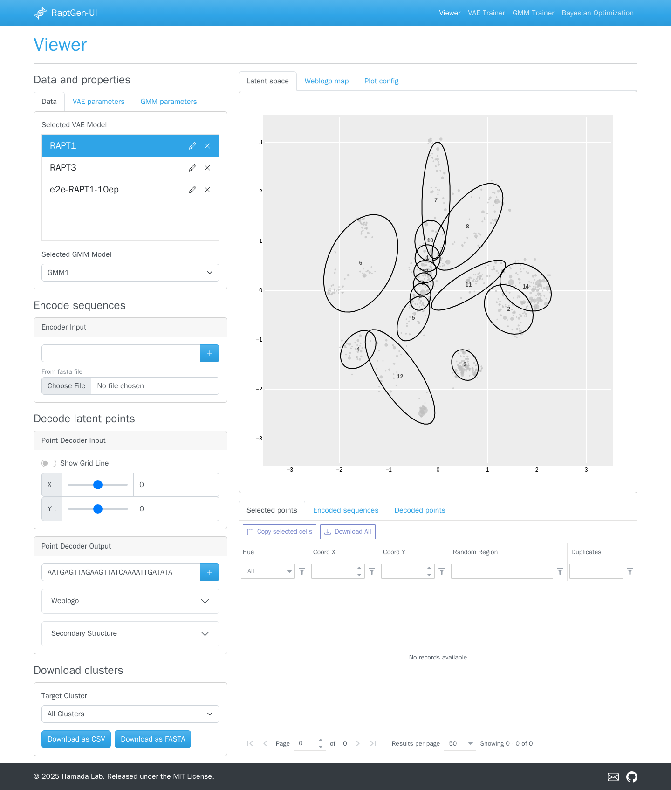
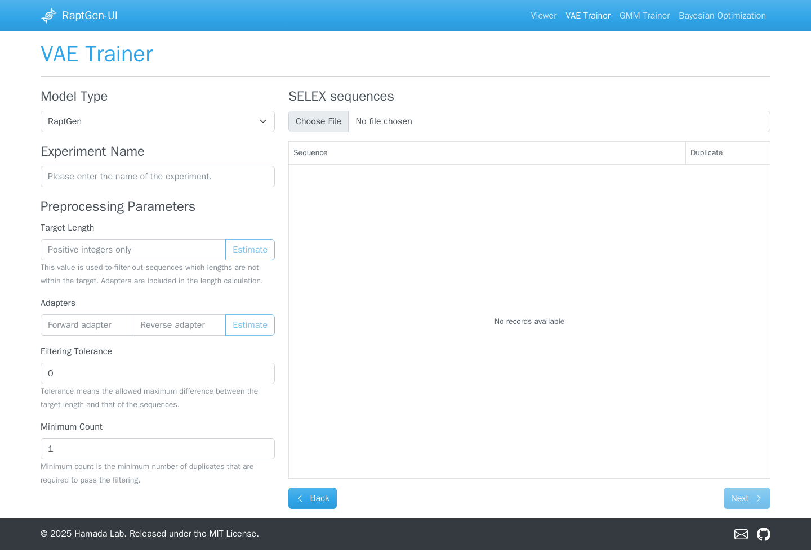
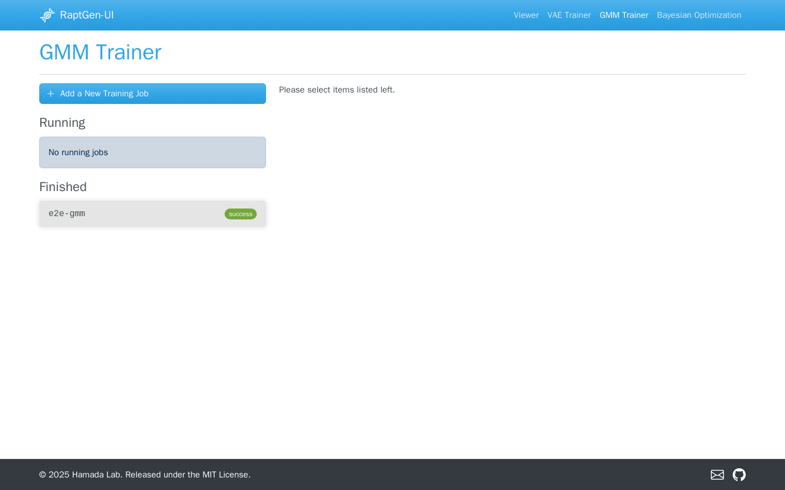
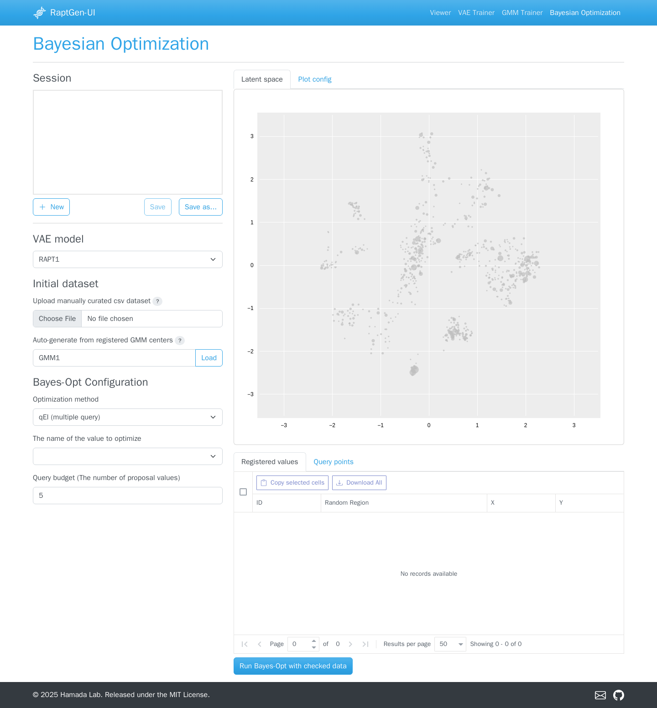
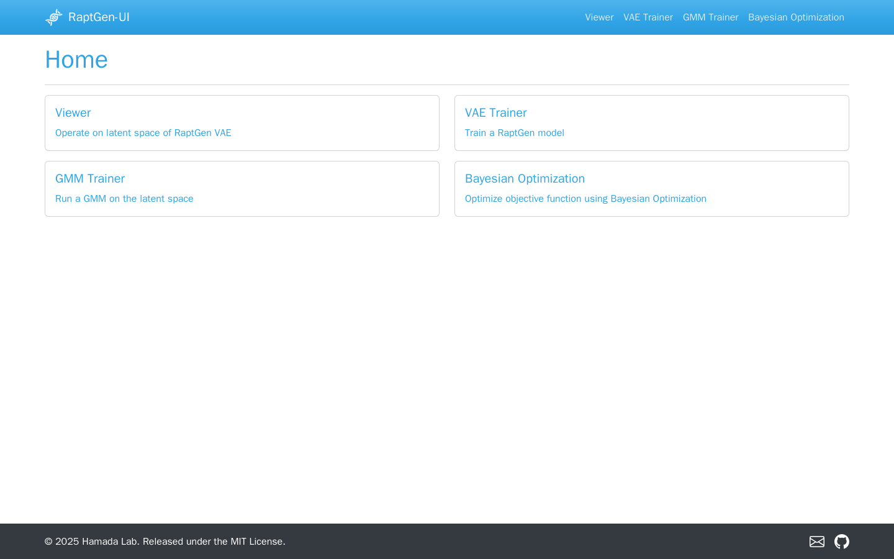

[English](ui.md) | [한국어](ui.ko.md)

# 사설 EC2에서 RaptGen-UI 실행

이 가이드는 [RaptGen-UI](concepts.ko.md#raptgen-ui가-하는-일)를 **public IP, 인바운드 규칙, SSH 키가 모두 없는** EC2 인스턴스 한 대에서 실행합니다. 접속은 **SSM 포트 포워딩**으로 합니다. AWS Systems Manager Session Manager가 내 컴퓨터의 `localhost:18042`에서 인스턴스의 18042 포트까지 암호화된 터널을 열어 주는 방식입니다. 인터넷에는 아무것도 노출되지 않습니다.

기술 참조: [`raptgen/ui/README.md`](../../raptgen/ui/README.ko.md). 터널 없이 브라우저로 접속하고 싶다면 선택 사항인 [웹 접속](ui-web.ko.md)을 보세요. 먼저 그 문서의 경고를 읽으세요.

## 먼저 보안

RaptGen-UI는 자기 컴퓨터에서 쓰도록 설계되었습니다.

| 발견 | 상태 | 의미 |
|---|---|---|
| 로그인 | 없음 | 포트에 닿는 누구나 데이터를 보고, 학습하고, 모델을 지울 수 있습니다. |
| 원본 포트 설정 | 모든 인터페이스에 공개 | 그대로 클라우드에 올리면 네트워크에 열립니다. 이 저장소의 패치는 loopback에서만 공개합니다. |
| DB 비밀번호 | `postgres/postgres`, 원본에 고정 | DB 포트는 컨테이너 밖에 공개되지 않습니다. 여러 사람이 쓰기 전에 바꾸세요. |

그래서 여기서 지원하는 접속 방법은 사설 호스트로의 SSM 포트 포워딩뿐입니다. 공개 데이터 또는 민감하지 않은 서열 데이터만 사용하세요.

## 시작하기 전에

- [`getting-started/10-network`](../getting-started/10-network.ko.md)의 공용 네트워크 (스택 `<prefix>-network`, 기본 prefix `aptamer-workflows`). 호스트는 컨테이너 이미지와 소스를 받아야 하므로 NAT gateway를 통해 밖으로 HTTPS가 나갈 수 있는 private subnet이 필요합니다.
- CloudFormation 스택(IAM role 포함) 생성, SSM 명령 전송(`ssm:SendCommand`), SSM 세션 시작(`ssm:StartSession`) 권한이 있는 AWS CLI v2 자격 증명.
- AWS CLI용 [Session Manager plugin](https://docs.aws.amazon.com/systems-manager/latest/userguide/session-manager-working-with-install-plugin.html). `session-manager-plugin --version`으로 확인하세요.
- 비용: 인스턴스(기본 `m7i.2xlarge`)는 켜져 있는 동안, 200 GiB 암호화 디스크와 네트워크 스택의 NAT gateway는 계속 요금이 부과됩니다. 끝나면 호스트를 멈추거나 지우세요. 해당 Region의 요금 페이지를 확인하세요.

```bash
export AWS_REGION=<REGION> AWS_DEFAULT_REGION=<REGION>
export STACK_PREFIX=aptamer-workflows
```

## 1단계. 호스트 만들기

네트워크 output을 읽고 private subnet 하나를 고릅니다.

```bash
VPC_ID=$(aws cloudformation describe-stacks --stack-name "$STACK_PREFIX-network" \
  --query "Stacks[0].Outputs[?OutputKey=='VpcId'].OutputValue" --output text)
SUBNET_ID=$(aws cloudformation describe-stacks --stack-name "$STACK_PREFIX-network" \
  --query "Stacks[0].Outputs[?OutputKey=='PrivateSubnetIds'].OutputValue" --output text | cut -d, -f1)
echo "$VPC_ID $SUBNET_ID"
```

VPC id와 subnet id 하나가 보여야 합니다. 호스트를 배포합니다.

```bash
aws cloudformation deploy --stack-name "$STACK_PREFIX-raptgen-ui" --capabilities CAPABILITY_IAM \
  --template-file raptgen/ui/ec2.yaml \
  --parameter-overrides VpcId="$VPC_ID" PrivateSubnetId="$SUBNET_ID" NamePrefix="$STACK_PREFIX"

INSTANCE_ID=$(aws cloudformation describe-stacks --stack-name "$STACK_PREFIX-raptgen-ui" \
  --query "Stacks[0].Outputs[?OutputKey=='InstanceId'].OutputValue" --output text)
echo "$INSTANCE_ID"
```

호스트는 Amazon Linux 2023, 암호화된 gp3 디스크, IMDSv2 필수, SSM role, TCP 443 outbound만 허용입니다 (SSM, GitHub, 컨테이너 레지스트리가 필요로 하므로 기본값은 `0.0.0.0/0`입니다. 네트워크가 허용하면 `HttpsEgressCidr` 파라미터로 좁히세요). EC2 콘솔에서 public IP가 없는 것을 볼 수 있습니다. 1~2분 뒤 **Systems Manager > Fleet Manager**에 managed node로 나타납니다. 2단계 전에 이것을 기다리세요. (그때 첫 부팅 스크립트가 아직 패키지를 설치하고 있을 수 있는데, `install.sh`가 끝날 때까지 기다립니다.)

## 2단계. RaptGen-UI 설치

```bash
raptgen/ui/install.sh --instance-id "$INSTANCE_ID"
```

스크립트는 SSM 명령 하나를 보내 첫 부팅 설정이 끝나기를 기다린 뒤 Docker Compose와 Docker Buildx plugin(버전 고정, checksum 검증. Amazon Linux의 docker 패키지에는 `docker compose build`에 필요한 Buildx가 없습니다)을 설치하고, 고정된 commit의 RaptGen-UI를 clone하고, 아래 패치를 적용한 뒤 `docker compose up -d --build`를 실행합니다. 끝날 때까지 기다리며 stderr와 stdout의 마지막 부분을 차례로 보여 줍니다. 첫 빌드는 15~30분 걸립니다 (검증 실행에서는 12분). 마지막에 이렇게 나옵니다.

```text
RaptGen-UI is up on 127.0.0.1:18042
```

1단계의 호스트는 outbound TCP 443만 허용하므로 `install.sh`는 HTTPS 전용 apt 패치를 기본으로 적용합니다. 80 포트도 열린 네트워크의 호스트라면 `--apt-http`로 이 패치를 건너뛸 수 있습니다. 웹 접속 옵션에서는 `--bind-private-ip`를 추가하세요. [ui-web](ui-web.ko.md)을 보세요.

### 패치가 하는 일

원본 코드(`13cad83`)는 클라우드 호스트에서 그대로는 동작하지 않습니다. 작은 패치 세 개와 선택 패치 하나가 필요합니다 ([`raptgen/ui/patches/`](../../raptgen/ui/patches/)).

| 패치 | 문제 | 변경 |
|---|---|---|
| `0001-frontend-bookworm-base.patch` | frontend 이미지가 `node:20.2-slim`(Debian 11) 기반입니다. 보안 저장소가 없어져 빌드가 404로 실패합니다. | `node:20-bookworm-slim` 사용 |
| `0002-relative-api-base.patch` | 브라우저 코드가 `http://localhost:18042/api`를 호출합니다. 호스트 자신에서만 동작하고 터널이나 웹 접속에서는 동작하지 않습니다. | 상대 경로 `/api` 호출 |
| `0003-publish-on-bind-address.patch` | 포트가 모든 인터페이스에 공개됩니다. | `${UI_BIND_ADDR:-127.0.0.1}:18042`로 공개. 기본값은 loopback |
| `optional/0001-https-only-apt.patch` | TCP 443은 되지만 80 포트가 막힌 네트워크 (`ec2.yaml` 호스트 포함). 기본 적용, `--apt-http`로 건너뜀 | HTTPS apt와 호스트 CA bundle 사용 |

이전 테스트 실행에서 빌드는 약 9분 걸렸습니다. 이미지 크기는 backend와 worker가 각 약 5.4 GB, frontend가 762 MB였습니다.

## 3단계. 터널과 UI 열기

```bash
raptgen/ui/connect.sh --instance-id "$INSTANCE_ID"
```

`Forwarding localhost:18042 -> 127.0.0.1:18042 ...`가 보이고, 이어서 Session Manager가 포트가 열렸고 연결을 기다린다는 메시지를 보여 줍니다. 이 터미널은 열어 두세요. 브라우저에서 <http://localhost:18042>를 엽니다. 터널을 닫으려면 Ctrl-C를 누릅니다. 내 컴퓨터에서 18042 포트가 사용 중이면 `--local-port 18043`을 추가하세요.

### 화면

| 화면 | 용도 |
|---|---|
| Home | 네 가지 도구로 가는 시작 화면 |
| VAE Trainer | FASTQ/FASTA 올리기, primer 추정, 모델 학습, 진행 보기 |
| GMM Trainer | 학습된 지도에서 최적 군집 수 찾기 |
| Viewer | 지도, encode와 decode, 서열 로고, 2차 구조, 군집 다운로드 |
| Bayesian Optimization | 실험값을 넣고 다음 후보 서열 받기 |

| Viewer: latent 지도와 GMM 타원 | VAE Trainer: 실행 중 / 완료된 job |
|---|---|
|  |  |

| 새 학습 job 폼 | GMM Trainer | Bayesian Optimization |
|---|---|---|
|  |  |  |

Home 화면: 

## 4단계. API로 테스트 (선택)

`raptgen/ui/tests/e2e_api.py`는 화면과 같은 순서를 API로 실행합니다. Python 3과 RaptGen-UI 저장소의 샘플 FASTQ `initdb/RAPT1_4R.fastq`만 있으면 됩니다 (호스트에도 `/opt/raptgen-ui/RaptGen-UI/initdb/RAPT1_4R.fastq`로 설치되어 있습니다).

3단계의 터널을 연 상태에서, 그 FASTQ의 로컬 사본으로 실행합니다.

```bash
python3 raptgen/ui/tests/e2e_api.py --base-url http://localhost:18042 \
  --fastq <RAPT1_4R.fastq 경로> --epochs 10
```

| # | 단계 | 기대 결과 |
|---|---|---|
| 1 | Viewer: 기본 모델 RAPT1 열기, encode, decode | OK |
| 2 | 업로드, 길이와 primer 추정 | 길이 89, 앞/뒤 primer 발견, random region 30 nt |
| 3 | VAE 학습, 10 epoch, 고유 서열 3,043개 | `vae.done: success` |
| 4 | 모델을 Viewer에 등록 | OK |
| 5 | GMM 학습, 군집 2~6개 | `gmm.done: success`, 최적 2 |
| 6 | 군집 중심 decode | 서열이 반환됨 |
| 7 | Bayesian optimization (qEI, 후보 3개), decode | 서열이 반환됨 |

마지막에 `ALL: PASS`가 나옵니다. 스크립트가 `e2e-RAPT1-<N>ep`, `e2e-gmm` 모델을 만들므로 끝나면 Viewer에서 지우세요.

**이전에 기록된 결과** (RaptGen-UI `13cad83` + 이 저장소의 패치, CPU 모드, `m7i.2xlarge` 8 vCPU, 32 GB): 7단계 모두 통과했습니다. 10 epoch VAE 학습은 251초, GMM 단계는 10초 걸렸습니다. 정리된 로그는 [`raptgen/results/ui/`](../../raptgen/results/README.ko.md)에 있습니다.

결과는 이렇게 읽으세요.

- Bayesian optimization에 넣은 값은 **가짜 숫자**(1, 2, ...)입니다. 소프트웨어가 동작함을 보여 줄 뿐입니다.
- 10 epoch 학습 뒤에는 생성된 서열에 `_`, `N` 기호가 섞입니다. **서열 품질을 판단한 테스트가 아닙니다.**
- CPU 학습 속도: 고유 서열 3,043개는 epoch당 약 20초, 전체 고유 서열 38,513개는 epoch당 약 4.4분입니다. 전체 서열에 원본 기본값(조기 종료 포함 최대 1,000 epoch)을 쓰면 CPU로는 수 시간 이상 걸립니다.

| 검증일 | 결과 |
|---|---|
| 2026-11-26, us-west-2 | 새 스택에서 1, 2, 4단계 통과 (4단계는 SSM Run Command로 호스트에서 실행: `ALL: PASS`, 10 epoch VAE 242초). 3단계 SSM 포트 포워딩은 테스트 PC에 Session Manager plugin이 없어 실행하지 않았습니다. |

## UI 안의 RaptGen 버전

RaptGen-UI는 원본 RaptGen 패키지를 설치하지 않습니다. backend 안에 **RaptGen 코드를 다시 써서 넣은 자체 복사본**이 있습니다.

```text
원본 hmdlab/raptgen (2022-12, c4986ca)           RaptGen-UI backend/core/ (13cad83)
  raptgen/models.py   -- 옮겨 적고 고침 -->        algorithms.py       (CNN_PHMM_VAE, pHMM loss, decode, logo)
  raptgen/data.py     -- 옮겨 적고 고침 -->        preprocessing.py    (ID_encode, adapter 추정)
  scripts/real.py     -- 다시 씀 ---------->       train.py, jobs.py   (Celery 작업, DB 저장)
```

근거: `backend/core/jobs.py`에 원본 import 줄이 주석으로 남아 있고 (`# from raptgen.core.preprocessing import ...`), conda 파일 `environment-cpu.yml`, `environment-gpu.yml`에 `raptgen` 패키지가 없습니다.

| 바꾸고 싶은 것 | 방법 | 비고 |
|---|---|---|
| UI 안의 RaptGen 알고리즘 | RaptGen-UI의 새 commit을 받아 다시 빌드 (`git pull`, `docker compose build`) | 원본 RaptGen을 새로 받아도 UI는 바뀌지 않습니다. |
| PyTorch 버전 | `environment-*.yml`에 버전이 **고정되어 있지 않아** 빌드할 때마다 그날 conda가 고른 버전이 들어갑니다 | 같은 빌드를 재현하려면 직접 고정하세요. |
| BO 라이브러리 | `botorch=0.10.0` 고정 | |
| 이 저장소의 RaptGen Batch 이미지 | UI에 끼워 넣을 수 없음 | 코드 경로가 다릅니다. |

UI의 모델 클래스(`CNN_PHMM_VAE`)는 원본과 이름이 같지만, 두 코드가 같은 결과를 내는지는 **비교하지 않았습니다**.

## GPU 모드

RaptGen-UI에는 GPU용 compose 파일(`compose.gpu.yml`)이 있습니다. **여기서는 테스트하지 않았습니다.** 이 절은 코드와 설정을 읽은 내용입니다. 이 저장소의 `install.sh`는 CPU compose 파일로 시작합니다.

| 항목 | 내용 |
|---|---|
| 실행 | `docker compose -f compose.gpu.yml up -d` |
| 호스트 준비 | NVIDIA driver와 NVIDIA Container Toolkit |
| 장치 고르기 | VAE Trainer의 **Device**에 `CPU`, `CUDA:0`, `CUDA:1` ... 표시 |
| 동시 실행 | 장치마다 학습 2개까지 |
| GPU 이미지 | `nvidia/cuda:11.6.1-runtime-ubuntu20.04` + `pytorch-cuda=11.8` |
| GMM, BO | CPU로 실행 |

주의: CUDA 11.8 빌드는 RTX 50xx(Blackwell, sm_120)를 지원하지 않습니다. CUDA 12.8 이상용 PyTorch가 필요합니다. AWS의 A10G(`g5`)와 L4(`g6`)는 원칙적으로 CUDA 11.8에서 동작합니다. GPU 이미지가 지금도 그대로 빌드되는지는 확인하지 않았습니다. [benchmark](benchmark.ko.md)에서 보듯 GPU는 RaptGen 학습을 조금만 빠르게 합니다.

## 멈추기와 정리

- Ctrl-C로 터널을 닫습니다.
- 비용을 줄이려면 EC2 콘솔에서 인스턴스를 중지하거나(데이터는 디스크에 남습니다. 다시 켠 뒤 UI가 올라오지 않으면 `install.sh`를 다시 실행하세요) 스택을 지웁니다.

  ```bash
  aws cloudformation delete-stack --stack-name "$STACK_PREFIX-raptgen-ui"
  ```

- 모델은 인스턴스 디스크의 PostgreSQL 볼륨에 있습니다. 스택을 지우면 함께 사라집니다.

다음: [선택: 웹 접속](ui-web.ko.md) | [목차](README.ko.md)
