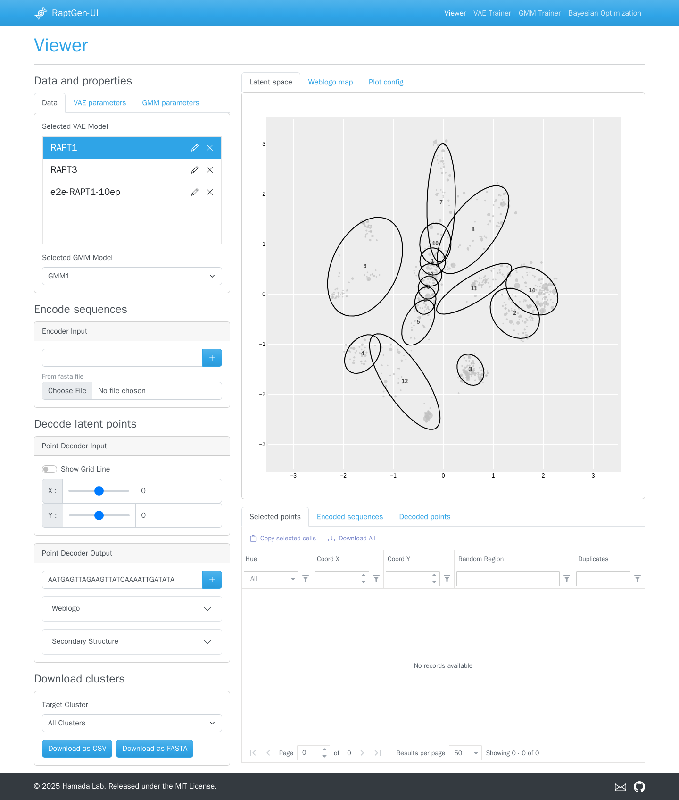
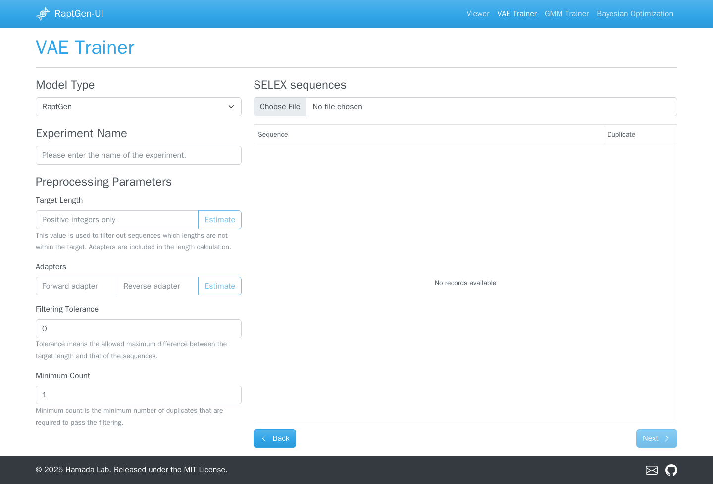
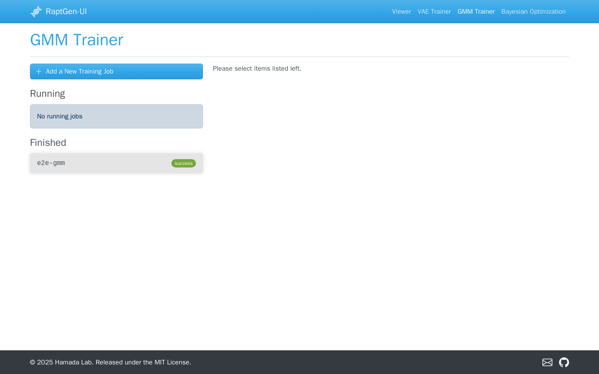
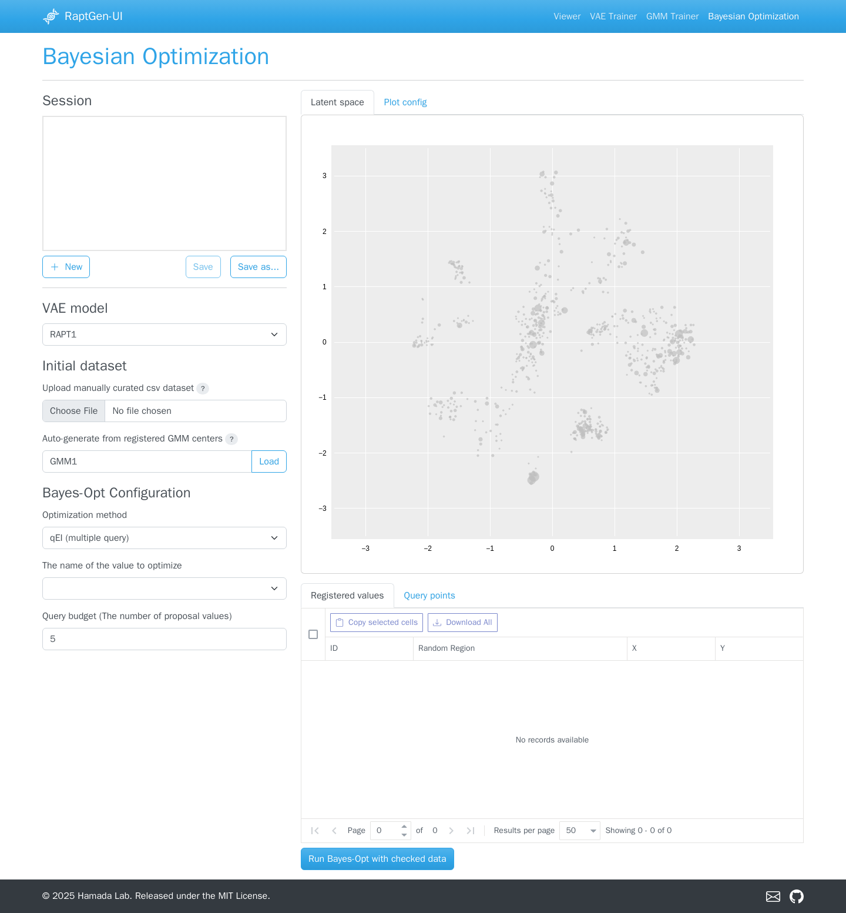
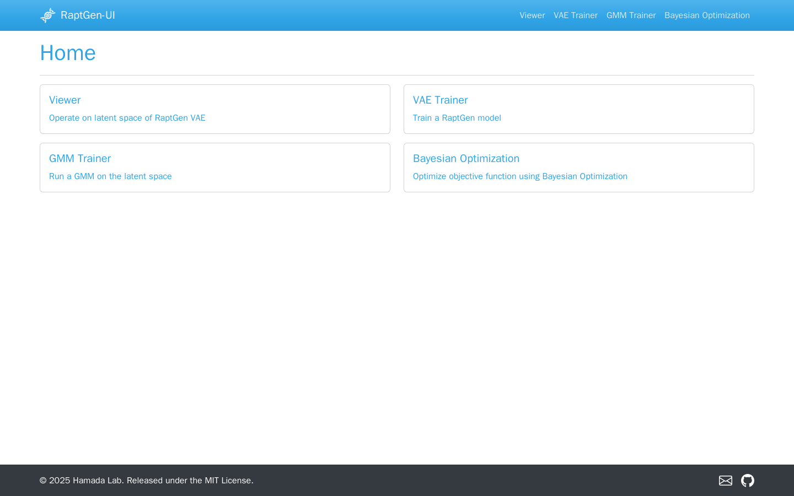

[English](ui.md) | [한국어](ui.ko.md)

# RaptGen-UI on a private EC2 host

This guide runs [RaptGen-UI](concepts.md#what-raptgen-ui-does) on one EC2 instance that has **no public IP, no inbound rule and no SSH key**. You reach it from your computer through an **SSM port forward**: AWS Systems Manager Session Manager opens an encrypted tunnel from `localhost:18042` on your computer to port 18042 on the instance. Nothing is exposed to the internet.

Technical reference: [`raptgen/ui/README.md`](../../raptgen/ui/README.md). Want browser access without a tunnel? See the optional [web front door](ui-web.md) and read its warning first.

## Security first

RaptGen-UI was designed to run on your own computer.

| Finding | Status | What it means |
|---|---|---|
| Login | none | Anyone who can reach the port can view data, train and delete models. |
| Upstream port setting | published on all interfaces | Put on a cloud host as is, it is open to the network. This repo's patch publishes it on loopback only. |
| Database password | `postgres/postgres`, fixed upstream | The database port is not published outside the containers. Change it before any shared use. |

So the only supported access here is the SSM port forward to a private host. Use public or non-sensitive sequence data.

## Before you start

- The shared network from [`getting-started/10-network`](../getting-started/10-network.md) (stack `<prefix>-network`, default prefix `aptamer-workflows`). The host needs a private subnet with outbound HTTPS through the NAT gateway, to pull container images and clone the source.
- AWS CLI v2 with credentials that may create CloudFormation stacks with IAM roles, send SSM commands (`ssm:SendCommand`) and start SSM sessions (`ssm:StartSession`).
- The [Session Manager plugin](https://docs.aws.amazon.com/systems-manager/latest/userguide/session-manager-working-with-install-plugin.html) for the AWS CLI. Check with `session-manager-plugin --version`.
- Costs: the instance (default `m7i.2xlarge`) is billed while it runs, plus its 200 GiB encrypted disk, and the NAT gateway of the network stack. Stop or delete the host when you are done. Check the pricing pages for your Region.

```bash
export AWS_REGION=<REGION> AWS_DEFAULT_REGION=<REGION>
export STACK_PREFIX=aptamer-workflows
```

## Step 1. Create the host

Read the network outputs and pick one private subnet:

```bash
VPC_ID=$(aws cloudformation describe-stacks --stack-name "$STACK_PREFIX-network" \
  --query "Stacks[0].Outputs[?OutputKey=='VpcId'].OutputValue" --output text)
SUBNET_ID=$(aws cloudformation describe-stacks --stack-name "$STACK_PREFIX-network" \
  --query "Stacks[0].Outputs[?OutputKey=='PrivateSubnetIds'].OutputValue" --output text | cut -d, -f1)
echo "$VPC_ID $SUBNET_ID"
```

You should see a VPC id and one subnet id. Deploy the host:

```bash
aws cloudformation deploy --stack-name "$STACK_PREFIX-raptgen-ui" --capabilities CAPABILITY_IAM \
  --template-file raptgen/ui/ec2.yaml \
  --parameter-overrides VpcId="$VPC_ID" PrivateSubnetId="$SUBNET_ID" NamePrefix="$STACK_PREFIX"

INSTANCE_ID=$(aws cloudformation describe-stacks --stack-name "$STACK_PREFIX-raptgen-ui" \
  --query "Stacks[0].Outputs[?OutputKey=='InstanceId'].OutputValue" --output text)
echo "$INSTANCE_ID"
```

The host is Amazon Linux 2023, encrypted gp3 disk, IMDSv2 required, an SSM role, and egress on TCP 443 only (to `0.0.0.0/0` by default, because SSM, GitHub and the container registries need it; narrow it with the `HttpsEgressCidr` parameter if your network allows). In the EC2 console it shows no public IP. In **Systems Manager > Fleet Manager** it appears as a managed node after a minute or two. Wait for that before step 2. (The first-boot script may still be installing packages then; `install.sh` waits for it.)

**Hardened use:** after the install, narrow the egress with `HttpsEgressCidr` (for example your proxy) and/or `S3PrefixListId` plus VPC interface endpoints for SSM and ECR. The install itself needs GitHub, the container registries and package mirrors.

## Step 2. Install RaptGen-UI

```bash
raptgen/ui/install.sh --instance-id "$INSTANCE_ID"
```

The script sends one SSM command that waits for the first-boot setup to finish, installs the Docker Compose and Docker Buildx plugins (pinned versions, checksums verified; the Amazon Linux docker package has no Buildx, which `docker compose build` needs), clones RaptGen-UI at the pinned commit, applies the patches below, and runs `docker compose up -d --build`. It waits and prints the tail of stderr, then of stdout. The first build takes 15 to 30 minutes (12 minutes in the validation run). It ends with:

```text
RaptGen-UI is up on 127.0.0.1:18042
```

The host from step 1 allows outbound TCP 443 only, so `install.sh` applies the HTTPS-only apt patch by default. On a host whose network also allows port 80 you may add `--apt-http` to skip it. For the web option add `--bind-private-ip`; see [ui-web](ui-web.md).

### What the patches do

The upstream code at `13cad83` does not work on a cloud host as is. Three small patches are needed, plus one optional patch (in [`raptgen/ui/patches/`](../../raptgen/ui/patches/)):

| Patch | Problem | Change |
|---|---|---|
| `0001-frontend-bookworm-base.patch` | The frontend image is based on `node:20.2-slim` (Debian 11). Its security repository is gone, so the build fails with 404. | Use `node:20-bookworm-slim`. |
| `0002-relative-api-base.patch` | The browser code calls `http://localhost:18042/api`. That only works on the host itself, not through a tunnel or a web front door. | Call the relative path `/api`. |
| `0003-publish-on-bind-address.patch` | The port is published on all interfaces. | Publish on `${UI_BIND_ADDR:-127.0.0.1}:18042`: loopback by default. |
| `optional/0001-https-only-apt.patch` | Networks that allow TCP 443 but not port 80, such as the `ec2.yaml` host. Applied by default; `--apt-http` skips it. | apt over HTTPS with the host CA bundle. |

In the test run, the build took about 9 minutes. The images were about 5.4 GB each for backend and worker and 762 MB for the frontend.

## Step 3. Open the tunnel and the UI

> **Not exercised in validation.** The 2026-11-26 validation could not run `connect.sh` (the SSM port forward) because the test workstation had no Session Manager plugin. It checked the UI on the host through SSM Run Command instead (step 4). The tunnel follows the standard `AWS-StartPortForwardingSessionToRemoteHost` document, but treat this step as not yet validated.

```bash
raptgen/ui/connect.sh --instance-id "$INSTANCE_ID"
```

You should see `Forwarding localhost:18042 -> 127.0.0.1:18042 ...`, followed by the Session Manager message that the port is open and waiting for connections. Leave this terminal open. Open <http://localhost:18042> in your browser. Press Ctrl-C to close the tunnel. If port 18042 is busy on your computer, add `--local-port 18043`.

### The screens

| Screen | Use |
|---|---|
| Home | Entry page with links to the four tools |
| VAE Trainer | Upload FASTQ/FASTA, estimate primers, train a model, follow progress |
| GMM Trainer | Find the best number of clusters on a trained map |
| Viewer | Map, encode and decode, sequence logo, secondary structure, cluster download |
| Bayesian Optimization | Enter measurements, get the next candidate sequences |

| Viewer: latent map with GMM ellipses | VAE Trainer: running and finished jobs |
|---|---|
|  |  |

| New training job form | GMM Trainer | Bayesian Optimization |
|---|---|---|
|  |  |  |

Home page: 

## Step 4. Test through the API (optional)

`raptgen/ui/tests/e2e_api.py` walks the same path as the screens, using the API. It needs only Python 3 and the sample FASTQ `initdb/RAPT1_4R.fastq` from the RaptGen-UI repository (also installed on the host at `/opt/raptgen-ui/RaptGen-UI/initdb/RAPT1_4R.fastq`).

With the tunnel from step 3 open, and a local copy of that FASTQ:

```bash
python3 raptgen/ui/tests/e2e_api.py --base-url http://localhost:18042 \
  --fastq <path to RAPT1_4R.fastq> --epochs 10
```

| # | Step | Expected |
|---|---|---|
| 1 | Viewer: open the default model RAPT1, encode, decode | OK |
| 2 | Upload, estimate length and primers | length 89, forward and reverse primer found, random region 30 nt |
| 3 | VAE training, 10 epochs, 3,043 unique sequences | `vae.done: success` |
| 4 | Publish the model to the Viewer | OK |
| 5 | GMM training with 2 to 6 clusters | `gmm.done: success`, optimal 2 |
| 6 | Decode the cluster centers | sequences returned |
| 7 | Bayesian optimization (qEI, 3 candidates), decode | sequences returned |

It ends with `ALL: PASS`. The script creates the models `e2e-RAPT1-<N>ep` and `e2e-gmm`; delete them in the Viewer afterwards.

**Results recorded earlier** (RaptGen-UI `13cad83` with these patches, CPU mode, `m7i.2xlarge`, 8 vCPU, 32 GB): all seven steps passed. The 10-epoch VAE training took 251 seconds and the GMM step 10 seconds. The sanitized logs are in [`raptgen/results/ui/`](../../raptgen/results/README.md).

Read this result correctly:

- The Bayesian optimization values were **fake numbers** (1, 2, ...). The test only shows that the software runs.
- After 10 epochs the generated sequences still contain `_` and `N` symbols. This is **not a test of sequence quality**.
- Training speed on CPU: about 20 seconds per epoch for 3,043 unique sequences and about 4.4 minutes per epoch for all 38,513 unique sequences. Training with the upstream defaults (up to 1,000 epochs with early stopping) on all sequences would therefore take hours on CPU.

| Validated on | Result |
|---|---|
| 2026-11-26, us-west-2 | Steps 1, 2 and 4 passed on a fresh stack (step 4 run on the host through SSM Run Command: `ALL: PASS`, 10-epoch VAE 242 s). Step 3, the SSM port forward, was not exercised because the test workstation had no Session Manager plugin. |

## Which RaptGen version the UI contains

RaptGen-UI does not install the original RaptGen package. Its backend carries **its own re-written copy** of the RaptGen code:

```text
original hmdlab/raptgen (2022-12, c4986ca)        RaptGen-UI backend/core/ (13cad83)
  raptgen/models.py   -- copied and edited -->      algorithms.py       (CNN_PHMM_VAE, pHMM loss, decode, logo)
  raptgen/data.py     -- copied and edited -->      preprocessing.py    (ID_encode, adapter estimate)
  scripts/real.py     -- rewritten ----------->     train.py, jobs.py   (Celery jobs, database storage)
```

Evidence: `backend/core/jobs.py` keeps the original import lines as comments (`# from raptgen.core.preprocessing import ...`), and the conda files `environment-cpu.yml` and `environment-gpu.yml` have no `raptgen` package.

| To change | How | Note |
|---|---|---|
| The RaptGen algorithm in the UI | Take a newer RaptGen-UI commit and rebuild (`git pull`, `docker compose build`) | Updating the original RaptGen does not change the UI. |
| PyTorch version | The `environment-*.yml` files do **not** pin it, so each build picks what conda resolves that day | Pin it yourself if you need to reproduce a build. |
| BO library | `botorch=0.10.0` is pinned | |
| The RaptGen Batch images of this repo | Cannot be plugged into the UI | The code paths differ. |

The UI model class has the same name as the original (`CNN_PHMM_VAE`), but whether the two code bases give the same results was **not compared**.

## GPU mode

RaptGen-UI has a GPU compose file (`compose.gpu.yml`). **It was not tested here**; this section comes from reading the code and settings. In this repo, `install.sh` starts the CPU compose file.

| Item | Detail |
|---|---|
| Start | `docker compose -f compose.gpu.yml up -d` |
| Host needs | NVIDIA driver and NVIDIA Container Toolkit |
| Choosing the device | VAE Trainer shows `CPU`, `CUDA:0`, `CUDA:1` ... in **Device** |
| Parallel jobs | up to 2 training jobs per device |
| GPU image | `nvidia/cuda:11.6.1-runtime-ubuntu20.04` with `pytorch-cuda=11.8` |
| GMM and BO | run on CPU |

Notes: CUDA 11.8 builds do not support RTX 50xx (Blackwell, sm_120), which needs a PyTorch built for CUDA 12.8 or newer. AWS A10G (`g5`) and L4 (`g6`) GPUs work with CUDA 11.8 in principle. Whether the GPU image still builds today was not checked. As [benchmark](benchmark.md) shows, a GPU speeds up RaptGen training only a little.

## Stop and clean up

- Stop the tunnel with Ctrl-C.
- To save cost, stop the instance in the EC2 console (the data stays on the disk; if the UI does not come back after you start it again, run `install.sh` again) or delete the stack:

  ```bash
  aws cloudformation delete-stack --stack-name "$STACK_PREFIX-raptgen-ui"
  ```

- Models live in the PostgreSQL volume on the instance disk. Deleting the stack deletes them.

Next: [optional web access](ui-web.md) | [Index](README.md)
